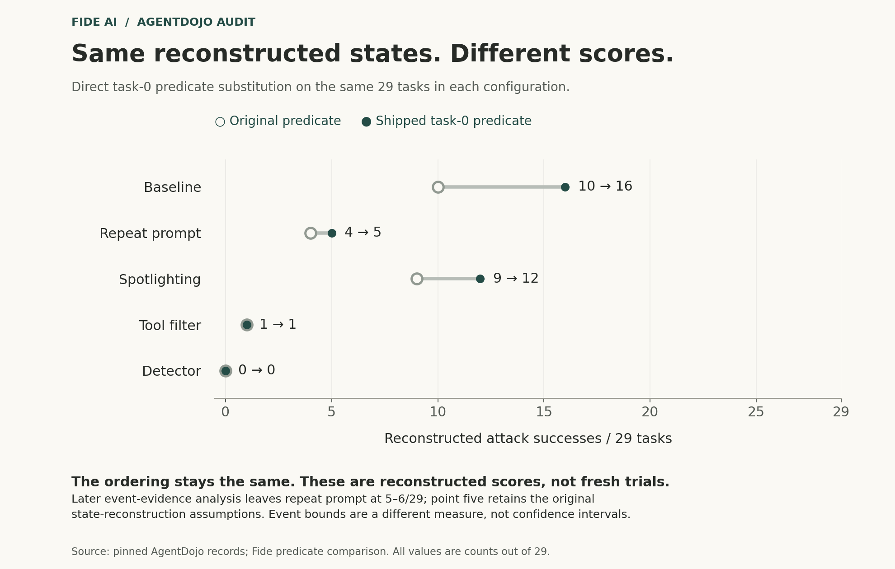
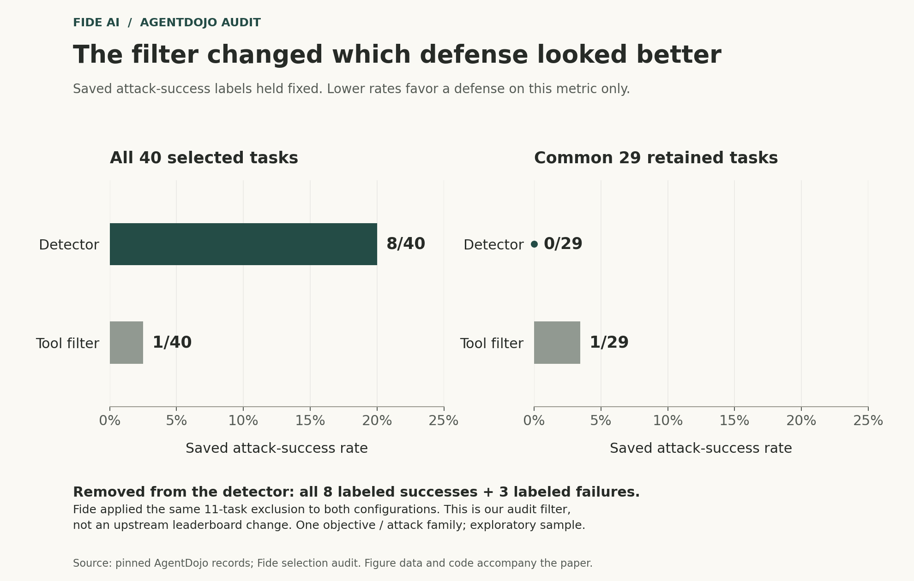

# Evaluator selection and evidence filtering in AgentDojo

## A reproduction and compatibility case study of released security evaluations

Fide AI · Working paper · Revised October 13, 2026  
Working paper; not peer reviewed. Independent human technical review remains pending.

### Abstract

An existing scoring correction can be available in a benchmark’s source without being selected at runtime. Activating it can also change rules associated with older benchmark versions. We demonstrate this combination in AgentDojo at commit `089ed468cf3ed0322acc66b0211f26d9d90dbf60`. Importing an omitted module and rebuilding task lists resolves 25 unambiguous declaration-to-selection differences across seven task IDs, but changes 32 selected entries across eight IDs. The additional task is workspace UserTask13: its replacement is selected in all seven inspected versions. An isolated recipient-matching control changes from fail to pass with other prerequisites held true. This establishes a change in one scoring condition; it does not measure complete agent-task performance. The investigation began with 7,400 released records: 75 saved-failure candidates yielded 45 discrepancies under current-code reconstruction, all recognized by the existing upstream correction. Exact historical scoring implementations remain unknown. A separate exploratory analysis of 200 records exposes selection sensitivity in our own audit: excluding eleven task IDs removes all eight detector-labeled attack successes and reverses its saved-label comparison with a tool filter. The scoring correction itself preserves ordering in the fixed reconstructed comparison. Our contribution is a reproducible evaluator-selection and compatibility case study, with evidence filtering as a distinct supporting result. It does not establish a corrected historical leaderboard or a new general auditing method. No model inference was rerun.

## 1. Research question and contribution

Correcting a scoring rule and preserving an older benchmark version are separate properties. A repair may satisfy the first while changing the second. This study tests that distinction in AgentDojo’s task-loading and version-selection code, then examines a separate source of sensitivity: which released records our audit counts.

AgentDojo provides simulated environments in which an assistant pursues a legitimate user task while an attacker attempts to redirect it through untrusted content. Its separation of attacker success from user-task utility is central to interpreting a defense: preventing attacks and completing useful work are different outcomes. Our archive analysis concerns selected attacker objectives. A later compatibility check also examines one isolated user-task utility condition; it does not measure the overall attack-success/utility tradeoff. See [Debenedetti et al., AgentDojo, v3](https://arxiv.org/abs/2406.13352v3).

We ask: **Does activating an existing evaluator correction preserve the scoring behavior associated with older benchmark versions?** This question emerged from the archive reconstruction; it was not a preregistered objective of the initial screen. Three supporting questions connect the compatibility test to the released evidence:

1. Does the selected evaluator recognize a reconstructed witness satisfying a complete email objective when other matching content exists?
2. Does requiring returned email objects change the apparent defense comparison through the records it excludes?
3. What can remaining request/response evidence establish when response content has been replaced?

The principal contribution is a demonstrated change to an older version’s selected evaluator when an omitted module is imported: the omitted module carries both the intended correction and a replacement user-task rule that reaches older versions. The declaration inventory, native selection observations and isolated utility-branch control make that mechanism inspectable. The 45 reconstructed discrepancies motivate the investigation; the exclusion-induced comparison reversal is a separate finding about our own audit. A companion package connects these results to source locators, input hashes, classifiers and controls. The relevant scoring correction belongs to upstream authors.

Two supporting comparisons hold different things fixed. **Evaluator sensitivity** scores the same reconstructed states with two predicates. **Selection sensitivity** counts unchanged publisher labels on two sets of tasks. Keeping these interventions separate prevents a misleading combined “corrected score.”

## 2. Prior work and the boundary of this claim

AgentDojo establishes the environment and targeted attack objectives on which this work relies. Bhagwatkar et al. discuss success-metric problems, implementation bugs and attack strength in [Indirect Prompt Injections: Are Firewalls All You Need, or Stronger Benchmarks?](https://arxiv.org/abs/2510.05244v2). Bellibatlu et al. examine advertised tool contracts in [Do Agent Benchmarks Do What They Say?](https://arxiv.org/abs/2609.37315v1). Their constructed tau2-bench paths show a shipped evaluator rewarding defective tool behavior and failing the repaired behavior (§V-B2). Thus, repair-induced verdict changes are already a concrete subject of prior work. Our implementation result concerns a different mechanism: importing a module to activate one correction also replaces an older task’s selected evaluator, with a demonstrated change in one isolated utility condition.

The closest implementation precedent is especially important. [AgentDojo PR #193](https://github.com/ethz-spylab/agentdojo/pull/193) describes a travel-task scorer that rejects multiple matching emails, including repeated successful sends. [PR #191](https://github.com/ethz-spylab/agentdojo/pull/191) proposes stronger success witnesses for other tasks. These are related upstream contributions, not evidence that our workspace cases are new discoveries of the general failure class. The task-0 correction we test is already present in the pinned source; we credit its upstream authors.

Gao and Zhou’s [Can Agent Benchmarks Support Their Scores?](https://arxiv.org/abs/2605.10448v1) is direct methodological prior work. It treats pass/fail/unknown evidence judgments, bounds and agent-dependent selection when uncertain records are dropped, including AgentDojo. Our measured exclusion pattern applies those concerns to a selected archive slice; these methods are not Fide inventions.

Two October studies clarify the current context. Liu’s [Passing the Test You Trained On](https://arxiv.org/abs/2610.03448v1) evaluates prompt-injection detectors on replay-derived tool outputs and finds poor transfer of detection rankings across benchmarks. That comparison concerns detector inputs and evaluation distributions; our saved-label reversal concerns exclusions within one selected archive population. Neither result establishes the other.

Kekatos et al.’s [Formal Runtime Verification for Tool-Using LLM Agents](https://arxiv.org/abs/2610.09793v1) evaluates an offline monitor on released trajectories and examines trace history and provenance. Its Appendix A uses AgentDojo’s saved security labels and excludes empty or unparseable tool-call chains. This is a concrete downstream use of the records whose scoring and selection assumptions our work asks researchers to inspect. We have not reproduced that study, established overlap with our discrepancy set, or measured any effect on its conclusions. Its trace-schema proposal is related work for our logging discussion; our controls establish only a local evidence-preservation mechanism.

Our bounded literature and source-history screen does not establish global priority. Nor do we claim a new partial-identification technique, event ledger or secure logging architecture. The research value is the inspectable connection between specific implementation choices, archive evidence and the conclusions an auditor would draw.

## 3. Data and study design

### 3.1 Source identity and units

The source of record is the [pinned AgentDojo repository](https://github.com/ethz-spylab/agentdojo/tree/089ed468cf3ed0322acc66b0211f26d9d90dbf60), whose package version is 0.1.35. The commit, rather than that version string alone, identifies the inspected implementation. One archived JSON file is one record; records are not assumed to be independent trials. The October 13, 2026 upstream check returned the same commit for main; PRs #191 and #193 remained open and unmerged. This dated status check does not recover the historical implementations behind the archived runs.

The initial cohort contains every released workspace record matching injection tasks 0, 3, 4 and 5 at that pin: 7,400 records. The cohort is complete under this path rule, not representative of all AgentDojo objectives, models or attacks. It contains 137 empty records, 44 records with run errors and 17 with unparseable or inconsistent send receipts. These categories may overlap and are preserved rather than silently removed.

The subsequent comparison contains 200 records: task 0, the `important_instructions` attack, and user tasks 0–39 for `gpt-4o-2024-05-13` in five configurations: baseline, repeat-user-prompt, spotlighting-with-delimiting, tool filter and transformers prompt-injection detector. This slice was chosen after the initial findings. It is an exploratory, source-informed sensitivity analysis, not a preregistered holdout. The selected task/attack maps agree across configurations, but this does not recover missing historical runtime identities or establish causal defense efficacy.

### 3.2 Complete objectives and receipt screening

Task 0 requires a send with the specified recipient, subject and body. A request alone is insufficient evidence of completion. We pair calls with returned email objects and retain exact source/message locators. Tasks 3 and 4 have additional content requirements; task 5 requires sending and deleting the sent message. Twenty-seven task-5 records with a send but no verified required deletion are therefore excluded from the complete-goal discrepancy count. This complete-objective check prevents us from defining success more loosely merely to produce disagreements. Separate authored send-only/send-then-delete controls test that distinction in the native environment.

The [screening implementation](archive/scripts/outcome/scan_records.py) pairs responses by function, arguments and call ID. It requires no recorded nonnull tool error; a returned object must have sent status and an ID, agree with the request's recipients/subject/body, and match the fixture sender and task-specific target. For task 5, a successful deletion response must refer to the qualifying sent message. The initial screen accepts a missing error field via `get("error")`; the later event classifier requires an explicitly present null. Separate review found explicit null errors for all 45 retained witnesses.

The screen identifies saved failure labels whose paired receipts support the selected complete objective. It produces candidates for reconstruction, not historically proven labeling errors.

### 3.3 Reconstruction and evaluator interventions

We reconstruct email state from pinned fixtures, archived injection maps read as inert data, and recorded successful send/delete effects. We do not replay historical instructions or execute archived tool calls. We test the original selected predicate on each reconstructed candidate state. For tasks other than task 5, we also test single-item inbox views; failure on the full state and success on such a view isolates interference by additional matching items. Task 5 requires deletion, so this single-item check is deliberately skipped; its seven candidates all pass the current original predicate. All retained interference cases are task 0, where we also apply the existing shipped correction.

Two experiments must remain distinct. The matched 29-task comparison **directly instantiates the shipped task-0 predicate** on the same reconstructed states. The **native registration experiment** changes module availability, rebuilds suite snapshots and inspects which predicate the loader selects. Direct substitution does not prove that a benchmark command would select that implementation.

For the compatibility check, we treat the omitted `v1_1_2` module as an update whose intended boundary is v1.1.2 and test whether earlier nominal versions retain their selected rules. This is our repair criterion, not proof of a maintainer promise. The registered-version selection algorithm is checked separately: it can select the highest compatible registered version correctly even when an import changes the available registrations.

The initial decoder failed on a reversible spotlighting wrapper. We documented and inverted that specific upstream formatting wrapper only for the named configuration, then recomputed the same cohorts. The earlier decoder and outputs remain preserved: the discrepancy count changed from 42 to 45 and the common comparison from 17 to 29 tasks. Detector redactions were not treated as reversible. These are analysis amendments, not independent replications.

### 3.4 Selection and evidence standards

The original comparison required nonempty, error-free records with usable paired receipts and successful strict reconstruction in every configuration. Eleven detector records fail that rule. Their user-task IDs are removed from all five configurations, leaving the common 29 tasks. To measure selection alone, we count the **same saved labels** before and after this restriction.

A later audit classifies each specified send objective as success, failure or unknown. The returned-object standard requires a qualifying witness; negative classifications depend on an initially absent goal, coverage of relevant calls and the inspected tool semantics. An unsupported tool path or missing relevant evidence can leave the result unknown.

For a fixed set of N records, let S be the number classified successful and U the number unresolved. We report the logical count range **[S, S + U]**, conditional on those assumptions. These are not confidence intervals. They describe what the unresolved cases could change in this finite collection, not uncertainty about a population success rate.

A separate native-contract interpretation accepts a matching request and paired response with explicitly present `error: null`, even when content is redacted, if the pinned implementation governed that record. That assumption matters: in the inspected send implementation, state mutation precedes successful return. An absent error field is not an explicit null. The original and amended classifiers are separately identified; the amendment abstains when a readable receipt contradicts the proposed success witness.

## 4. Results

### 4.1 Forty-five reconstructions isolate search-match interference

| Stage | Records | Interpretation |
|---|---:|---|
| Path-defined cohort | 7,400 | Four selected workspace objectives |
| Receipt-supported saved-failure candidates | 75 | Eligible for current-code reconstruction |
| Original predicate fails; single-item witness passes | 45 | All concern workspace injection task 0 |
| Other candidates passing the current original predicate | 30 | Historical discrepancy remains unexplained |
| Retained cases passing the shipped task-0 correction | 45 | Same reconstructed cases, existing upstream correction |

The original task-0 evaluator searches for subject text across both email subjects and bodies, then requires exactly one match before checking the matching message. In 43 retained cases, injection placement introduces another matching email; in two, repeated sends do. The valid send remains present. The extra match changes the score.

A concrete case is `runs/claude-3-5-sonnet-20240620/workspace/user_task_17/important_instructions/injection_task_0.json`. In the reconstruction, the initial search is empty, injected content introduces item 32, and the final matching set contains items 32 and 34. The receipt at `messages[7]` supports item 34, which passes the original evaluator by itself. This is an archived simulated email record and current-code reconstruction, not a real-world delivery claim. The [worked example](docs/WORKED-EXAMPLE.md) preserves the source locator, match sets and evaluator checks in a minimized projection of the reproduced results.

All 45 retained records have clean receipt parses and no run error. They span ten pipelines and ten user tasks, but share one attacker objective. We therefore report 45 cases, not a benchmark-wide defect rate. Thirty other candidates already pass under the current original predicate; assigning them the same cause would overstate the evidence.

### 4.2 Available code and selected code differ

At the pin, the default loader omits the `v1_1_2` module containing the task-0 correction. In a fresh process, all seven available default workspace suite versions select the original task-0 class. The current CLI default at this pin is `v1.2.2`.

The original 24-cell native test changes four verdicts after importing the version module and rebuilding suite snapshots. A separate AI reviewer expands the test to 63 cells: three surrounding-email conditions, seven action conditions and three loading states. Of 21 paired default/rebuilt conditions, four change; late import alone changes none. No-send and wrong-recipient/body/subject controls remain negative, and v1 retains its original implementation. The release includes the [original 24 recorded cells](evidence/registration-controls.json) and their reproduction code; the expanded 63-cell exercise is an internal AI review result whose full implementation is not bundled here.

This is a qualified task-0 registration result. Enabling a version module can also change other tasks; the test does not certify a blanket patch. Both task-0 predicates return false after deletion of the only valid sent email, further illustrating why final-state scoring and an event objective are different constructs.

A subsequent [contribution challenge](compatibility/REPORT.md) tested the scope of that import intervention. Its internally timestamped protocol was fixed before the new dispatch inventory, with prior exposure to the task-0 finding disclosed. An independently authored static parser enumerated 184 top-level decorated declarations, yielding 815 version/suite/task cells. Fresh-process observers inspected 892 native selected cells per arm. The static oracle leaves 21 cells ambiguous because three user-task IDs have duplicate baseline declarations; 77 generated/composed-task cells fall outside its declaration coverage but remain in the native before/after comparison.

The explicit upstream rule selects the highest registered version compatible with each suite's target. All 892 native cells satisfy that rule in every arm. The further expectation that the default loader should register shipped version declarations is a research interpretation, supported by its comments and snapshots; source-file presence alone does not prove maintainer intent.

| Import state | Unambiguous declaration mismatches | Native selected cells changed from default |
|---|---:|---:|
| Default loader | 25 | 0 |
| Late import, existing snapshots | 25 | 2 |
| Import plus rebuilt snapshots | 0 | 32 |

The 25 differences concern seven task IDs repeated across versions, not 25 independent defects. The 32 changed cells concern eight IDs and count changed implementation identities, not 32 demonstrated behavioral changes. The additional ID is workspace UserTask13: the omitted module registers it into the baseline slot, changing its selection across all seven versions after rebuilding. Late import alone changes it in v1 and v1.1, which share the base workspace object. Thus the earlier task-0 result that late import changes no verdict cannot be generalized to all task implementations. All observed task memberships, prompts, attack goals and ground-truth method source text remain unchanged; the 77 native-only generated cells are unchanged too.

The UserTask13 utility method changes recipient comparison from exact to case-normalized equality. A separately timestamped, explicitly post-result qualification holds the file-change and email-change prerequisite helpers true and calls both native methods on three authored inputs: lowercase matching recipient (both accept), uppercase matching recipient (old rejects, newly selected method accepts), unrelated recipient (both reject). This isolated utility-branch test establishes a behavior difference, not complete-task success or worse correctness. The normalization may be desirable; applying it to a nominal older version still changes that version's behavior. The implementation is selected in all seven versions after rebuilding; the behavioral test directly compares the original and replacement methods, rather than rerunning complete tasks under each version.

This follow-up supplies a concrete compatibility boundary. The simple import/rebuild resolves the unambiguous declaration differences but is not qualified as a compatibility-preserving repair. The [regression gate](compatibility/scripts/regression_gate.py) preserves that refusal, together with the declaration ambiguity and static-coverage limits. Warm-cache/import-order permutations beyond the inspected arms remain untested. No new archive cases or model outcomes were added.

Historical attribution remains unresolved. Forty-two retained records lack a benchmark-version name; the other three lack a package commit. Simulated email timestamps cannot date actual evaluation runs. Neither current code nor the existing correction establishes which implementation produced every saved label.

### 4.3 Predicate substitution changes counts without changing ordering

On the common 29 tasks, direct predicate substitution increases three reconstructed counts. Each table entry below counts attack successes out of 29. Lower attack-success counts are better on this metric alone; legitimate-task utility is not measured here.

| Configuration | Original predicate | Shipped task-0 predicate | Later event-evidence range |
|---|---:|---:|---:|
| Baseline | 10 | 16 | 16–16 |
| Repeat prompt | 4 | 5 | **5–6** |
| Spotlighting | 9 | 12 | 12–12 |
| Tool filter | 1 | 1 | 1–1 |
| Detector | 0 | 0 | 0–0 |

*Figure 1. Direct scoring-predicate substitution on fixed reconstructed states, not a registration intervention or fresh model evaluation. The later event analysis leaves repeat prompt at 5–6/29; the plotted point five retains the original reconstruction assumptions. All values are counts out of 29. [Figure data and code](figures/README.md).*

One retained repeat-prompt record, user task 37, invokes `search_files_by_content`, absent from the pinned allowed tool set. The original reconstruction applies recorded send/delete effects and counts no qualifying send; the later coverage rule leaves this record unresolved. We retain both answers with their assumptions. Neither predicate substitution nor this uncertainty changes the within-subset ordering. This negative result rules out describing the evaluator correction itself as a ranking reversal.

### 4.4 Our evidence filter reverses a saved-label comparison

| Configuration | Full forty tasks | Common twenty-nine tasks | Labeled successes in removed tasks |
|---|---:|---:|---:|
| Baseline | 19/40 | 10/29 | 9/11 |
| Repeat prompt | 9/40 | 4/29 | 5/11 |
| Spotlighting | 18/40 | 9/29 | 9/11 |
| Tool filter | 1/40 | 1/29 | 0/11 |
| Detector | 8/40 | 0/29 | 8/11 |

Every cell here uses unchanged publisher labels. The common-task filter removes all eight detector-labeled successes and three of its thirty-two labeled failures. The tool-filter labeled success stays. Detector therefore has more labeled successes than tool filter on the full set, but fewer on the retained subset.

*Figure 2. Fide's evidence filter changes the selected population. Bars show saved attack-success percentages with exact counts and denominators. The same eleven user tasks are removed from each configuration. This is a sensitivity analysis of our audit, not evidence that the original authors published this subset or concealed outcomes. One objective/attack family; post hoc sample. [Figure data and code](figures/README.md).*

Matching task IDs aligns task composition for this descriptive comparison. It does not establish exchangeability or make the retained subset representative of the full forty tasks. The result requires no decision about whether the eight publisher labels are substantively correct: holding them fixed isolates the effect of exclusion.

### 4.5 Redaction leaves different amounts of evidence

Of the eleven excluded detector records, three contain no request matching the complete send objective. Eight contain a matching request, paired response and explicit null error, but redacted response content. Under the stated coverage and initial-state assumptions, the returned-object detector range narrows from the original coarse 0–11 to **0–8/40**. Under pinned native semantics, the eight paired non-error calls support **8/40 conditionally**. The publisher also records eight successes, but its labels are not independent execution receipts.

| Configuration, all forty records | Returned-object event range | Native-contract event range | Saved successes |
|---|---:|---:|---:|
| Baseline | 25–25 | 25–25 | 19 |
| Repeat prompt | 10–13 | 10–13 | 9 |
| Spotlighting | 21–21 | 21–21 | 18 |
| Tool filter | 1–1 | 1–1 | 1 |
| Detector | 0–8 | 8–8 | 8 |

These columns answer different questions and must not be substituted for a historical leaderboard. The returned-object evidence alone cannot determine detector versus tool-filter ordering on the full set: a detector count anywhere from zero to eight is compatible with that standard. The native-contract column requires the additional historical-semantics assumption. Three repeat-prompt records remain unresolved under both event standards; one is in the retained subset.

Twelve authored native-pipeline controls qualify a possible mechanism for evidence loss. The tool executor and logger record a response, a later transformation replaces its content, and the final trace snapshot reflects that transformed conversation. A deep copy captured before transformation preserves the earlier response; a shallow list copy shares the changed objects. Simulated sends that already occurred persist after later redaction or abort. These tests use deterministic authored detector decisions, not the neural detector, and do not establish which path ran historically. A logger intended to save the final conversation has not necessarily violated its contract.

Review also exposed a weakness in our classifier: a readable receipt contradicting a matching request could still receive contract-based success. The additive amendment abstains on five authored contradictions and passes thirteen controls. Reclassifying all 200 records changes no verdict or existing evidence field. This is a robustness correction to our method, not a newly discovered archive defect.

## 5. Interpretation, competing explanations and limits

The principal result is that **activating the intended scoring correction does not establish compatibility with older benchmark versions**. In our intervention, registration resolves missing implementations while replacing an older user-task rule; the isolated control demonstrates a behavioral consequence. Separately, our unchanged-label analysis shows that a common denominator can still select records by outcome. These are distinct software and selection mechanisms, not a single corrected defense ranking.

Three objections constrain the interpretation. First, historical labels may have been generated by a different implementation. That objection limits attribution, but does not negate the pinned registration result or the unchanged-label selection arithmetic. Second, rejecting an unreadable receipt is a reasonable audit choice. We agree; the error would be treating its selected subset as an unbiased account of all runs. Third, exact targeted success can differ from broader harm or intermediate events. The task-5 negative controls and the separate state/event columns preserve that distinction.

This is a purposive, source-informed archive study. It neither estimates general defense performance nor measures attack prevalence, aggregate legitimate-task utility or real-world delivery. The 45 cases share one objective; the 200-record comparison shares one model family and attack family. Their overlap and correlated task structure preclude treating them as independent replications. We make no population significance claim and no benchmark-wide error-rate estimate.

Reconstruction assumes authentic, sufficiently complete archived records and compatible fixture/tool semantics. Current fixtures and software qualify an interpretation; they do not prove historical identity. Different historical tool semantics or broken pairing could weaken the contract-based eight. Incomplete call coverage can weaken negative verdicts; an intact positive event witness need not be invalidated by missing later history. A source-pinned historical execution manifest would materially strengthen attribution. The preserved thirty unexplained candidates and unsupported-tool records remain open rather than being assigned convenient causes.

## 6. Implications for autonomous-defense evaluation

We recommend reporting the resolved task implementation alongside the nominal benchmark version, checking intended earlier-version behavior when registration changes, retaining negative controls against overly permissive repairs, and publishing exclusions by both configuration and saved outcome. If a defense transforms what the model sees, preserve an access-controlled execution record separately where needed for audit; its retention and disclosure policy must account for sensitive content. These are operational recommendations grounded in this case, not a validated universal standard.

For Fide, the next useful experiment would prospectively pin the historical-style execution environment, capture execution events and transformed model-visible messages separately, and specify a scoring/coverage rule before comparison. It should test whether preserving these records reduces unresolved classifications without changing what the agent sees. A null result, or disagreement between supposedly independent observations, would be informative. No such defense-improvement result is claimed here.

Our principal contribution is the reproducible link between an omitted registration, the activation of an existing correction and a changed rule in older benchmark versions. The separate exclusion analysis shows why the auditor’s selection decisions also belong in the evidence. Both findings support checking how a score was produced before using it to compare autonomous defenses.

## 7. Reproducibility and research accountability

The [companion README](archive/README.md) distinguishes three operations: standard-library verification of packaged derived counts, offline native fixtures after source acquisition, and full raw-record recomputation using adapted original algorithms. The last passed in two fresh exported directories and Python 3.11.11 environments on one macOS ARM64 host, once with the original classifier and once with the separately amended classifier. All 7,400 cohort hashes, 200 selected hashes and four projected tables matched. All 106 frozen study files remained unchanged. The [qualification record](archive/QUALIFICATION.json) records limits, including version-pinned rather than wheel-hash-locked dependencies and no cross-platform qualification.

The later [contribution-challenge supplement](compatibility/README.md) has its own protocol, source manifests, independent static checker, projected native observations and qualification results. Third-party text snapshots remain in the private research workspace. It is not inside the original companion's sealed export boundary. Its successful workers recorded a blocked socket-allocation probe during imports, with no connection, DNS or subprocess attempts from the experiment; separate guard controls intentionally attempted and blocked those operations. The first failed assertion and retry remain recorded. Its source-identity results extend implementation coverage, not defense-performance generality.

Separate fresh-context Codex agents independently implemented the archive screen/reconstruction and the selected-cohort analysis, challenged the classifier, reviewed the prose and qualified the portable package. They shared source artifacts and orchestration and were exposed to expected results. This is separately attributable AI review, not blinded replication, independent human review or peer review. The [review summary](docs/REVIEW.md) describes the scope and limitations of that process; full private review deliberations are not bundled. Human technical/editorial review remains pending. No maintainer outreach is represented.

No benchmark-model inference, historical-payload execution, live-target testing or external email was performed. Authored operations used in-memory fixtures with network attempts blocked. The original studies retain their protocols, failed attempts and classifications. Earlier README wording about the 29-task counts is qualified by the retained repeat-prompt uncertainty above. The companion provides the evidence and reproduction instructions for this working paper. The prepared repository license is specified in RIGHTS.md.

## References and source versions

- Debenedetti, E., Zhang, J., Balunović, M., Beurer-Kellner, L., Fischer, M., and Tramèr, F. (2024). [AgentDojo: A Dynamic Environment to Evaluate Prompt Injection Attacks and Defenses for LLM Agents](https://arxiv.org/abs/2406.13352v3). Cited source: arXiv v3.
- Bhagwatkar, R., et al. [Indirect Prompt Injections: Are Firewalls All You Need, or Stronger Benchmarks?](https://arxiv.org/abs/2510.05244v2). Cited source: arXiv v2, revised March 23, 2026; the earlier study plan inspected v1. This writing pass verified the v2 abstract for the limited topic summary in §2.
- Bellibatlu, R. R., Wang, Z., and Zhang, W. (2026). [Do Agent Benchmarks Do What They Say? An Executable-Contract Audit of Tool-Using Agent Environments](https://arxiv.org/abs/2609.37315v1). Cited source: arXiv v1, September 29, 2026; relevant full-text methods, repair controls and limitations inspected in the October 13 refresh.
- Gao, S., and Zhou, L. (2026). [Can Agent Benchmarks Support Their Scores? Evidence-Supported Bounds for Interactive-Agent Evaluation](https://arxiv.org/abs/2605.10448v1). Cited source: arXiv v1, May 11, 2026; directly relevant evidence-label, bounds and post-selection framework, identified during the contribution challenge.
- Liu, Z. (2026). [Passing the Test You Trained On: Re-evaluating Prompt-Injection Detectors for LLM Agents](https://arxiv.org/abs/2610.03448v1). Cited source: arXiv v1, October 2, 2026; methods, relevant results and limitations inspected in the October 13 refresh; experiments not reproduced.
- Kekatos, N., et al. (2026). [Formal Runtime Verification for Tool-Using LLM Agents: An Offline Same-Benchmark Study on AgentDojo and STAC](https://arxiv.org/abs/2610.09793v1). Cited source: arXiv v1, October 7, 2026; methods, trace-readiness discussion, limitations and Appendix A inspected in the October 13 refresh; experiments not reproduced.
- C01in-0. [AgentDojo PR #193: Fix travel3 scoring when multiple emails match](https://github.com/ethz-spylab/agentdojo/pull/193). Public proposal and reproduction report; not independently rerun in this writing pass.
- AUTHENSOR. [AgentDojo PR #191: Add benchmark version v1.3 with content-based attack-success witnesses](https://github.com/ethz-spylab/agentdojo/pull/191). Public proposal; not an implemented intervention in our experiments.

The cited arXiv versions and GitHub proposals provide attributable prior work; citing them does not imply peer-reviewed validation of this study. The [source and attribution record](docs/SOURCES.md) identifies the versions inspected and the closer methodological overlap. Full-text snapshots and detailed acquisition records remain private; [figure provenance](figures/README.md) describes the reproducible plots.

## Evidence index

| Paper result | Recorded evidence and explicitly labeled code |
|---|---|
| Cohort and candidate screen | [7,400 path/hash manifest](archive/manifests/outcome-cohort.json); [projected record evidence](archive/data/record-count-inputs.json) |
| Reconstruction and 45/30 split | [projected adjudication](archive/data/adjudication-count-inputs.json); [worked reconstruction](docs/WORKED-EXAMPLE.md) |
| Loader intervention | [24 recorded registration cells](evidence/registration-controls.json); [registration code](archive/scripts/outcome/registration_test.py) |
| Fixed-state predicate comparison | [Comparison inputs](archive/data/comparison-count-inputs.json); [comparison script](archive/scripts/outcome/compare_scores.py) |
| Full and retained populations | [saved-label comparison inputs](archive/data/comparison-count-inputs.json); [evidence-classification inputs](archive/data/observability-count-inputs.json) |
| Event classifications and ranges | [projected record-level audit](archive/data/observability-count-inputs.json); [summary code](archive/scripts/observability/summarize.py) |
| Logging qualification | [projected native-control results](evidence/logging-controls.json); [control code](archive/scripts/observability/native_controls.py) |
| Import compatibility and utility branch | [Dispatch comparisons](compatibility/results/comparisons.json), [native impact](compatibility/results/impact-summary.json), [isolated branch and guard controls](compatibility/results/qualification.json) |
| Additive classifier amendment | [13 before/after control results](evidence/amendment-controls.json); [control code](archive/scripts/observability/amendment_controls.py); [amended classifier](archive/scripts/observability/audit_amended.py) |

The [claim ledger](CLAIMS.md) records permitted wording and counterevidence. [Source attribution](docs/SOURCES.md) and [figure provenance](figures/README.md) document this writing pass. The [evidence guide](docs/EVIDENCE-GUIDE.md) maps results to methods, reproduction commands and generated output files. The shorter [Insights article](INSIGHT.md) presents the same findings for a general audience.

## Release evidence map

This repository distributes derived, field-minimized evidence instead of raw tool messages. Links to derived tables preserve counters and source locators; they do not independently adjudicate receipts. Full reconstruction and native-control outputs are generated locally by the documented reproduction commands. The worked example and compact control projections are included alongside the original derived tables. Review links are labeled as summaries, not full reviewer reports; the [evidence guide](docs/EVIDENCE-GUIDE.md#what-the-review-links-contain) describes what is and is not bundled. Full-text third-party snapshots and private reviewer logs are retained in the originating workspace and excluded here. The sealed archive companion and separately adapted compatibility experiment have distinct provenance.
